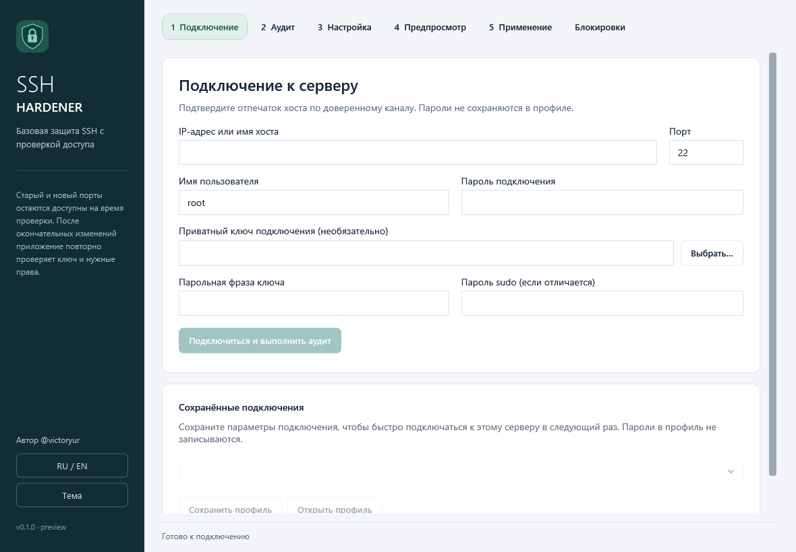

# SSH-Hardener

Windows-приложение для аудита и первичной настройки SSH-доступа к Linux-серверам. Автор: **@victoryur**.

**Предварительная версия 0.1.** Полная матрица Linux/VM-приёмки пока не подтверждена. Не считать успешную сборку доказательством безопасности изменений на рабочем сервере.

Приложение использует SSH.NET, показывает план команд и проверяет новый ключевой сеанс перед фиксацией поддерживаемых изменений. Неизвестные комбинации init, firewall и SSH-настроек должны отклоняться до применения. Требования ко всему продукту находятся в [уточнённом ТЗ](docs/REQUIREMENTS.ru.md); этот документ также описывает ещё не реализованные модули.



## Возможности первого выпуска

- Подключение по паролю или приватному ключу, ручное подтверждение SHA256 host key и локальное закрепление идентичности.
- Аудит ОС, SSH, полномочий, службы и сетевой конфигурации.
- План ключевого доступа и смены порта с предпросмотром команд, серверным откатом и проверкой свежего SSH-сеанса.
- История операций без сохранения паролей: после перезапуска можно подставить исходное или новое подключение, проверить состояние на закреплённом сервере и запросить доступный ручной откат.
- Установка Fail2ban на Debian/Ubuntu, отдельная SSH-защита с journal backend и исключением адреса администратора. По умолчанию — бан на час после 3 ошибок за 10 минут и отдельный лимит 3 попытки на одно SSH-соединение. Значения настраиваются.
- Работа с поддерживаемыми ключами; встроенная генерация RSA 4096 в зашифрованном PuTTY PPK v3 или PKCS#8 PEM. Существующий RSA-ключ можно экспортировать в PPK v3 с тем же отпечатком для RDM/PuTTY. [Форматы и экспорт ключей](docs/KEYS.ru.md).
- Отчёты без паролей и приватных ключей, RU/EN и локальное хранение настроек.

Конкретные ограничения задаются проверками PlanBuilder. Целевая первая матрица — systemd Debian 12/13, Ubuntu 22.04/24.04 и Rocky/AlmaLinux 9; наличие ОС в этом списке само по себе не разрешает автоматическое применение. Socket activation, произвольные nft/iptables rulesets, нестандартные Match/Include и неподдерживаемый firewall требуют отдельной реализации. Для минимальных контейнеров и остальных дистрибутивов используйте аудит.

Административный sudo в этой версии настраивается только явно подтверждённым NOPASSWD. Парольный sudo для нового пользователя, restricted sudo и SFTP/chroot не заявлены готовыми. Не включайте NOPASSWD без понимания, что это полный административный доступ.

SSH-транспорт отклоняет устаревшие SHA-1/DSA/CBC-варианты; RSA с SHA-2 остаётся доступен. Старый сервер может потребовать обновления, а не автоматического ослабления клиента. Генерация Ed25519/OpenSSH-v1, FIDO/агенты, 2FA, массовая обработка, автообновления, PDF-генератор и числовой security score остаются целевыми модулями и не заявлены реализованными. HTML-отчёт можно распечатать в PDF средствами браузера.

## Сборка и запуск

Нужны Windows x64 и .NET SDK 10.0.402 (версия закреплена в global.json). Поддержка Windows определяется действующей матрицей Microsoft; для Windows 10 учитывайте редакцию LTSC/Enterprise и её жизненный цикл.

Из корня репозитория:

```powershell
dotnet restore
dotnet build -c Release --no-restore
dotnet test tests/SSHHardener.Tests/SSHHardener.Tests.csproj -c Release
dotnet run --project src/SSHHardener.App/SSHHardener.App.csproj
```

Если SDK выбран через `global.json`, установите указанную ветку SDK. Для unit-проверок shell и read-only firewall probe также нужны Git for Windows и Python 3 (launcher `py -3` либо путь в `SSH_HARDENER_TEST_PYTHON`). NuGet lock files сохраняются в Git: packages.lock.json для обычной сборки и packages.win-x64.lock.json для публикации. В CI зависимости проверяются в locked mode.

Для portable-поставки:

```powershell
dotnet publish src/SSHHardener.App/SSHHardener.App.csproj -c Release -r win-x64 --self-contained true -p:PublishSingleFile=true -p:IncludeNativeLibrariesForSelfExtract=true -p:PublishTrimmed=false -o artifacts/publish
```

Установщик: установите Inno Setup 6 и выполните:

```powershell
iscc packaging/SSHHardener.iss
```

Результат — `artifacts/installer/SSHHardener-Setup-0.1.0.exe`. Установщик работает для текущего пользователя. Без сертификата автора executable и установщик остаются **неподписанными**; Windows может показывать предупреждение издателя. CI создаёт проверочные артефакты и не публикует GitHub Release автоматически.

## Работа с сервером

1. Подготовьте консоль провайдера/гипервизора, резервную копию и тестовый сервер.
2. Подключитесь и сверьте отпечаток host key через независимый доверенный канал.
3. Выполните аудит, выберите новый порт и приватный ключ. Один публичный `.pub` недостаточен для автоматической проверки входа.
4. Проверьте план, срок отката, адрес администратора и внешний firewall. Разрешите новый порт также в security groups провайдера.
5. Примените план. До commit программа должна проверить окончательный вход и требуемые привилегии в новом соединении.

При выбранном Fail2ban недостающие `fail2ban`, `python3-systemd`, `iptables` и `nftables` устанавливаются из уже настроенных apt-репозиториев после подготовки автоотката. Для установки требуется срок отката не менее 10 минут. Служба nftables не включается: используется её средство чтения правил. Для RPM-систем необходимы заранее установленные зависимости. Чужая SSH-политика Fail2ban требует отдельного разбора. При откате возвращаются собственная конфигурация и состояние служб; установленные пакеты сохраняются.

Смена порта уменьшает шум сканирования, но не заменяет обновления ОС и OpenSSH. Не включайте общий deny incoming по одному списку слушающих портов. Не меняйте параллельно firewall/sshd другим инструментом во время транзакции.

## Данные и восстановление

Настройки и known-hosts приложения находятся в `%AppData%\SSHHardener`. Пароли не сохраняются по умолчанию. Генерируемый приватный ключ записывается в явно выбранный файл; защитите его passphrase и резервной копией. Нельзя отправлять приватный ключ в issue или включать его в отчёт.

Перед применением программа сохраняет отдельную защищённую DPAPI CurrentUser запись операции: её номер, исходные и новые параметры подключения, пути ключей и публичную идентичность сервера. Пароли, парольные фразы, содержимое приватных ключей и полный план в историю не входят. Если записать историю невозможно, применение не начинается. После перезапуска сохранённый статус показан как последнее известное состояние; право на откат определяется повторной проверкой сервера. Автоматического подключения или повторного применения при запуске нет. Операции, выполненные до появления истории, автоматически не импортируются; используйте их transaction ID и [инструкцию восстановления](docs/RECOVERY.ru.md).

Отмена и потеря соединения до commit должны привести к серверному откату. Сообщение «ожидается откат» означает, что его результат ещё не подтверждён. Если доступ не вернулся, откройте консоль провайдера и следуйте [инструкции восстановления](docs/RECOVERY.ru.md). При физическом/сетевом отказе автоматическое восстановление не гарантируется.

## Проверка

- Unit-тесты проверяют небезопасные входные данные, план и последовательность транзакции.
- [Docker SSH integration](tests/SSHHardener.IntegrationTests/README.md) проверяет реальную аутентификацию, транспорт и пользовательские файловые изменения; systemd-проверка в контейнерном сценарии изолирована от реального init.
- [VM acceptance](docs/VM-ACCEPTANCE.ru.md) описывает systemd, firewall, SELinux, reboot и fault-injection. Эти сценарии требуют отдельных машин и не считаются пройденными по факту наличия Docker-тестов.

[Фактические результаты проверок](docs/VALIDATION.ru.md) · [Модель угроз](SECURITY.md) · [Команды сервера](docs/COMMANDS.ru.md) · [Участие в разработке](CONTRIBUTING.md).

Лицензия на распространение пока не выбрана автором. Указание авторства не предоставляет дополнительных лицензионных прав.
