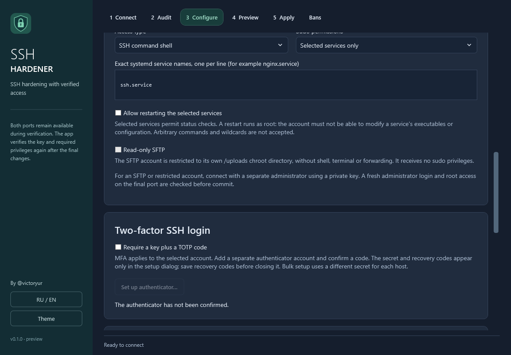

# Ключи, роли доступа, MFA, SFTP и массовые задания

Это руководство к предварительной реализации. Новые функции проверены unit- и
изолированными fixture-сценариями; их полный Apply, timer/boot recovery и fault
сценарии на настоящей systemd VM пока требуют [приёмки](VM-ACCEPTANCE.ru.md).
Подтверждённые ранее VM-прогоны перечислены отдельно в [VALIDATION](VALIDATION.ru.md).

## Подготовка

Начинайте с одноразовой VM, snapshot и консоли гипервизора. Для advanced access
на сервере заранее нужен Python 3; обычный Legacy-профиль без ранее управляемых
advanced-политик не требует его. Нужны sudo/visudo и стандартные инструменты
поддерживаемого профиля. Если Google Authenticator PAM отсутствует, Debian/Ubuntu
устанавливают `libpam-google-authenticator` из настроенных apt-репозиториев
**после arming**; срок отката должен быть не менее 10 минут. На других
дистрибутивах модуль устанавливает администратор заранее. Пакеты при rollback
не удаляются; чужой PAM/sshd/sudoers не заменяется без проверяемого владения.

Для непривилегированного, restricted или SFTP-only пользователя подключайтесь
отдельным администратором с рабочим приватным ключом. Парольного исходного
подключения недостаточно: после запрета SSH-паролей и final программа должна
открыть свежий сеанс этого администратора на новом порту, подтвердить root и
только затем commit. Target и control не могут быть одной такой учётной записью.
Если управляющий пользователь root, нельзя одновременно запретить его итоговый
вход. Host key закрепляется и для target, и для управляющего подключения.

## Выбор sudo и типа учётной записи



| Режим | Поведение |
| --- | --- |
| Legacy | Совместимость прежних параметров и существующего администратора; не является режимом снятия его прав. |
| None | Не выдаёт sudo; существующие sudo-права требуют ручного разбора. |
| Password | Полный sudo с паролем учётной записи. Для нового пользователя пароль задаётся через stdin; существующий проверяется без замены hash. |
| Passwordless | Явный NOPASSWD и полные root-права. |
| Restricted | Точный список systemctl-операций над конкретными `.service`; произвольный shell и wildcard запрещены. |

Для Password существующий пароль не сбрасывается. При откате нового аккаунта
блокируется только пароль, hash которого совпадает с установленным этой
операцией; изменённый администратором пароль сохраняется как конфликт.
Существующие права sudo, включая прежний managed grant, консервативно блокируют
применение None/Restricted/Password. Программа не объявляет полного
администратора ограниченным только по выбранной роли.

В Restricted укажите точные unit names. Разрешаются `is-active`, `is-enabled`,
`--no-pager --full status`; `restart` добавляется отдельно. Проверяются
root-владение и отсутствие записи другими пользователями у unit/drop-in и
исполняемых файлов. Это **не sandbox**: доверять нужно также конфигам,
скриптам, плагинам и поведению службы. Сервис, который исполняет управляемые
пользователем данные от root, может передать ему полномочия.

SFTP-only требует None. Chroot находится в
`/srv/ssh-hardener/sftp/<user>`: root-owned каталоги 0755, каталог `/uploads`
принадлежит пользователю и имеет 0700. Ключ остаётся вне chroot в обычном
домашнем каталоге. `internal-sftp` запрещает shell, TTY, forwarding, tunnel,
X11 и user rc; опция read-only дополнительно запрещает изменения файлов.
Наличие роли само по себе не доказывает confinement: перед commit проверяются
effective sshd policy и фактический SFTP-доступ.

Повторный Apply к уже управляемому SFTP-only пока отклоняется до arming:
программа не должна временно выдавать ему shell на dual-фазе.

## Включение key+TOTP

1. Выберите приватный ключ и роль; включите MFA и откройте настройку enrollment.
2. Добавьте показанный Base32 secret в аутентификатор вручную либо используйте
   показанный `otpauth://` URI. QR-код в текущем интерфейсе не создаётся.
3. Сохраните восемь recovery codes отдельно от компьютера/VM и подтвердите это
   в диалоге. Каждый код одноразовый; приложение не сохраняет его для вас.
4. Введите текущий шестизначный код из аутентификатора. Устаревший enrollment
   требует повторного подтверждения. Синхронизируйте часы Windows, сервера и
   устройства; перед arming проверяется расхождение часов клиента и сервера.
5. Проверьте план и примените. Final требует
   `publickey,keyboard-interactive:pam`; проверяются два свежих MFA-входа с
   разными TOTP time steps. Это может занять ожидание следующего 30-секундного
   интервала. При последующих подключениях вводится код либо recovery code.

PAM вставляет условный блок только для target; остальные пользователи проходят
исходный auth stack. Секрет расположен в `/etc/ssh-hardener/totp/<user>` и
доступен только root. Первоначальный mode 0600 может стать 0400 при штатной
атомарной записи Google PAM. Запрещены nullok, повторное использование кода и
password-only fallback. Заданы окно 3 time steps и rate limit 3 за 30 секунд.

Управляемые Match-фрагменты хранятся по пользователям с root-only proof и
добавляются в конец основного sshd_config. Новый профиль не снимает MFA других
аккаунтов. `EnableTotp=false` означает отсутствие нового enrollment и
**сохраняет** прежнюю управляемую MFA этого же пользователя; выключение MFA
отдельным действием сейчас не предоставляется. Повторный enrollment уже
управляемой MFA также блокируется до arming; для ротации нужен отдельный
проверенный переход без восстановления употреблённых recovery codes.
Прежняя MFA сохраняется и на dual-фазе: потребуется настоящий код.
Чужие изменения обнаруживаются
по proof, штатное потребление recovery codes и replay/rate-limit state допускается.
Root MFA нельзя сочетать с `PermitRootLogin prohibit-password/no`.

Seed, пароли и recovery codes передаются отдельно через sensitive stdin, не
печатаются в плане и не входят в историю, профиль, отчёт или CSV. Они остаются
в памяти клиента во время работы и в защищённых серверных enrollment/backup
файлах; не включайте их в issue, скриншот или публичный diagnostic bundle.

## SFTP-браузер

Откройте SFTP отдельной кнопкой. Параметры endpoint и путь ключа могут быть
подставлены, секреты исходного SSH-сеанса автоматически не переносятся:
введите их в окне браузера и сверьте host key. Доступны просмотр каталога,
upload/download, создание каталога, переименование и удаление. Удаление и
перезапись требуют подтверждения. Download использует локальный `.partial`,
который удаляется при отмене/ошибке до завершения. Право записи определяет
сервер; read-only SFTP должен отвечать отказом. Симлинки не используются для
перехода и изменяющих операций. После смены endpoint/пути требуется новое
подключение/чтение списка, чтобы действие не использовало устаревшую выборку.

Проверки симлинков описывают наблюдаемые parent/leaf paths. SFTP v3 не даёт
атомарного `openat`/`O_NOFOLLOW` для всей цепочки: защита от другого процесса,
подменяющего компоненты пути между запросами, не гарантируется.

## Массовая обработка

Сначала задайте общий шаблон политики в основном окне, затем откройте массовое
задание. Импортируйте локальные профили либо CSV с заголовками:

```csv
host,port,username,privateKeyPath,id,displayName
first.example,22,root,C:\fixture\control.ppk,first,Test server
```

Это вымышленные параметры. Допустимы только `host`, `port`, `username`,
`privateKeyPath`, `id`, `displayName`; обязателен `host`. Пароли, passphrase,
TOTP seed и коды в CSV запрещены. Лимиты: 256 endpoints, CSV до 1 MiB,
1–4 параллельных сервера. Начинайте с одного. Секреты и host-key approval
запрашиваются отдельно для каждого сервера; MFA enrollment уникален для хоста.

Выполните предпросмотр выбранных серверов: у каждого собственный аудит, pin и
план. Изменение списка/настроек/плана требует нового preview. После проверки
результатов подтвердите Apply. История каждого хоста записывается до его первой
мутации; невозможность сохранения блокирует этот host. Просмотренный план
используется однократно, включая неуспешную/отменённую попытку.

Результаты Committed, RolledBack, Unconfirmed, Failed и Skipped независимы.
Stop-on-first-failure прекращает назначение новых hosts; уже запущенные
транзакции не образуют общего атомарного отката. Cancel передаёт отмену и ждёт
пути восстановления активных операций. Локальная отмена не доказывает убийство
всех remote descendants; не называйте Unconfirmed успешным rollback. Для
повторения загрузите историю/состояние, устраните причину и создайте новый preview.

## Что проверено

[VALIDATION](VALIDATION.ru.md) разделяет unit/WPF fixtures, настоящий SSH/SFTP
транспорт и пользовательские VM-прогоны. Отдельные реальные key+TOTP проверки
production SSH.NET/SFTP выполняются по
[TotpAuthenticationScenario](../tests/SSHHardener.IntegrationTests/TotpAuthenticationScenario.README.md);
они используют изолированный PAM stack и не заменяют проверку его изменения
приложением или full Apply на VM. Текущий helper дополнительно проверен на
[сохранение существующих owned-политик](../tests/SSHHardener.IntegrationTests/OwnedAccessPolicyPreservation.README.md).
