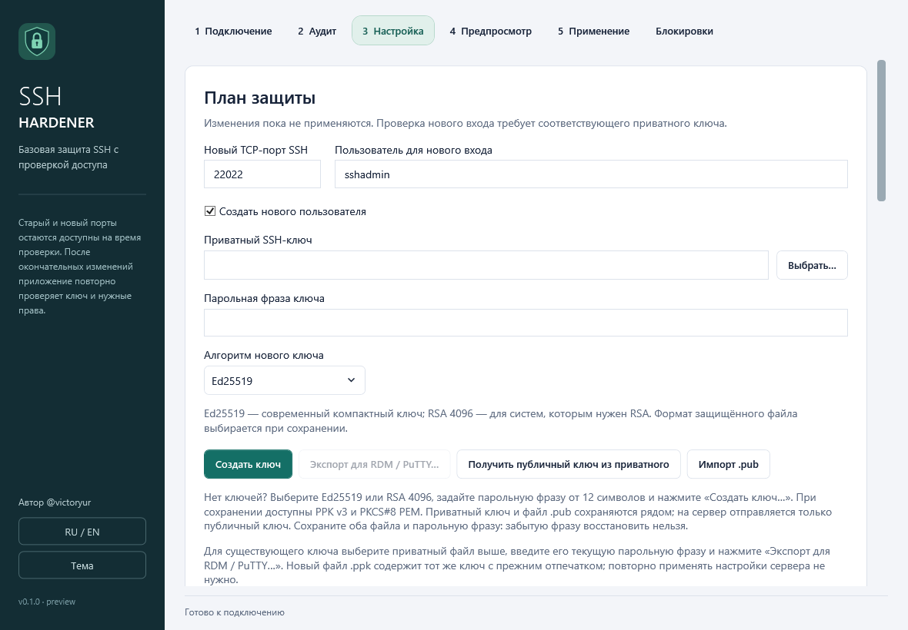

# Ключи и совместимость с RDM/PuTTY

На вкладке «Настройка» доступны генерация Ed25519/RSA 4096 и локальный экспорт существующего RSA/Ed25519-ключа. Подключение к серверу для экспорта не требуется. Ed25519 выбран в интерфейсе по умолчанию; для среды с ограничениями FIPS сначала проверьте допустимость алгоритма.

## Существующий ключ вызывает ошибку PKCS#8 в RDM

Некоторые варианты загрузчика SSH-ключей в Remote Desktop Manager не принимают выбранное шифрование PKCS#8. Ошибка чтения формата сама по себе не означает повреждение ключа или изменение доступа к серверу.

1. В поле «Приватный SSH-ключ» выберите прежний файл, например `sshadmin.pem`.
2. Введите его текущую парольную фразу в поле «Парольная фраза ключа».
3. Нажмите «Экспорт для RDM / PuTTY…» и выберите новое имя `.ppk`.
4. Программа сохранит зашифрованный PPK v3 и `.ppk.pub`, проверит расшифрование, MAC, совпадение публичного ключа и подпись. В сообщении результата показывается SHA256-отпечаток.
5. В RDM выберите полученный `.ppk` как приватный ключ PuTTY и используйте ту же парольную фразу. Файл `.pub` предназначен для публичной части.

Экспортируется та же RSA/Ed25519-идентичность. Серверная запись `authorized_keys` и исходный файл сохраняются; повторное применение плана для смены формата не требуется. Поддерживаются RSA 3072–16384 бит и Ed25519. Существующий файл назначения и его `.pub` не перезаписываются.

## Генерация нового ключа

Выберите Ed25519 или RSA4096 и нажмите создание ключа. Предлагается encrypted PPK v3 по умолчанию и encrypted PKCS#8 PEM вторым форматом. Оба защищены парольной фразой от 12 символов. Рядом создаётся публичный `.pub` в формате OpenSSH. Запись пары не перезаписывает существующие файлы; ACL текущего Windows-пользователя задаётся до приватных данных. До завершения программа читает созданный encrypted файл и проверяет совпадение публичной идентичности и подпись. Новый ключ имеет новую идентичность; его доступ устанавливается обычным планом.

PPK v3 использует Argon2id (64 MiB, 3 прохода, parallelism 1), AES-256-CBC и HMAC-SHA256. PKCS#8 использует AES-256-CBC с PBKDF2-HMAC-SHA256, 600000 итераций; Ed25519 private key кодируется по RFC 8410 внутри encrypted PKCS#8. Это не OpenSSH-v1. Параметры шифрования файлов не задают SSH transport cipher; транспортная политика отдельно отклоняет устаревшие варианты.

PPK предназначен для поддерживающих его клиентов, включая PuTTY и современные версии RDM. Консольный OpenSSH `ssh -i` требует совместимый PEM/OpenSSH-файл; расширение `.ppk` само по себе его не преобразует. Пользователь подтвердил успешное SSH-подключение в RDM 2026.2.14.0 после экспорта ключа в PPK v3; другие версии и SSH-движки требуют отдельной проверки. Подробности — в [результатах проверки](VALIDATION.ru.md).

RSA и Ed25519 PPK проверяются независимым PuTTYgen на disposable fixtures: требуется расшифрование приватной части и MAC, совпадение ключа и отказ с неверной фразой/изменённым комментарием. Четыре encrypted представления Ed25519 также проверены настоящей SSH.NET-аутентификацией. Это не подтверждение импорта нового Ed25519-файла в пользовательский RDM и не полная VM-приёмка новых ролей/MFA. Генерация формата OpenSSH-v1 и поддержка агентов/FIDO пока отсутствуют.

Спецификация: [PuTTY PPK](https://the.earth.li/~sgtatham/putty/0.85/htmldoc/AppendixC.html). Настройки клиента: [генератор SSH-ключей RDM](https://docs.devolutions.net/rdm/ribbon-menu-bar/tools/ssh-key-generator/).
